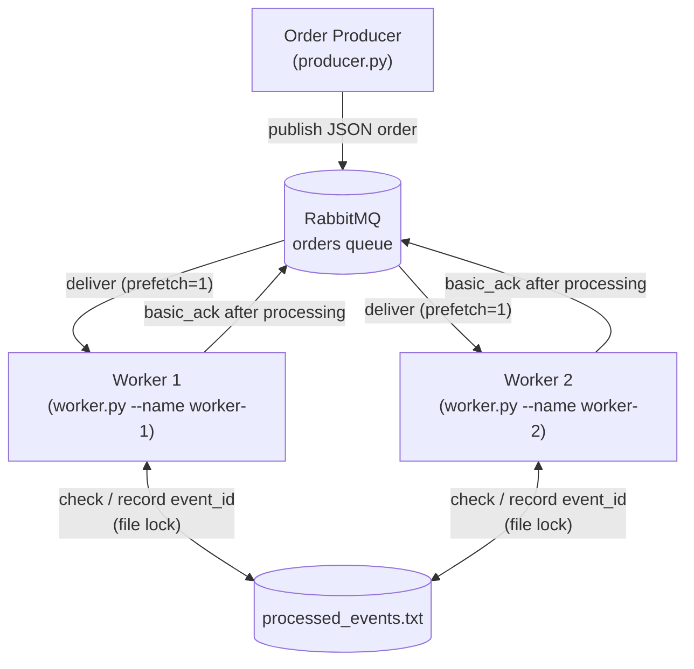

# CMPE 273 – Asynchronous Messaging with RabbitMQ

## 1. Overview

This project has two independent Python processes that talk through RabbitMQ:

- **Order Producer** (`producer.py`) publishes order events as JSON to a queue named `orders`.
- **RabbitMQ** stores the messages in the durable `orders` queue and delivers them to consumers.
- **Order Worker** (`worker.py`) consumes orders **asynchronously**, so the producer doesn't wait for processing.
- **Two workers** (`worker-1`, `worker-2`) can run against the **same** queue at the same time. They are *competing consumers*: RabbitMQ gives each message to only one of them.

Each worker uses **manual acknowledgements** (`auto_ack=False`). It ACKs a message only after processing finishes. It also records every processed `event_id` in a shared file, so a redelivered or duplicate message never runs the business action twice.

## 2. Architecture Diagram



There is only one queue. Worker 1 and Worker 2 both consume from it.

## 3. Message Contract

Every message body is JSON with exactly these fields:

```json
{
  "event_id": "event-629ac54a-89a2-48ef-827e-21af8f4e22cc",
  "order_id": "order-8e6afa7d-f691-4505-9efe-8d9267838c93",
  "item_id": "sku-807",
  "quantity": 3
}
```

| Field      | Meaning                                                        |
|------------|----------------------------------------------------------------|
| `event_id` | Unique ID of this event (UUID by default). Used for duplicate detection. |
| `order_id` | The order being processed.                                     |
| `item_id`  | The SKU being ordered.                                         |
| `quantity` | How many units.                                                |

**Why `event_id`?** RabbitMQ can deliver the same message more than once, for example after a worker crashes before ACK. A redelivered message carries the same `event_id`, so a worker can check whether that event was already handled and skip the business action.

## 4. Install Dependencies

Requires Python 3 and Docker (for RabbitMQ).

```bash
python3 -m venv .venv
source .venv/bin/activate
python -m pip install -r requirements.txt
```

`requirements.txt` contains only `pika==1.4.4`.

## 5. Run RabbitMQ

First time (creates the container):

```bash
docker run -d \
  --name cmpe273-rabbitmq \
  -p 5672:5672 \
  -p 15672:15672 \
  rabbitmq:3-management
```

If the container already exists (e.g. after a reboot), restart it instead of recreating it:

```bash
docker start cmpe273-rabbitmq
```

RabbitMQ takes a few seconds to start. Check that it is ready:

```bash
docker logs cmpe273-rabbitmq 2>&1 | grep "Server startup complete"
```

Optional: you can inspect the queue at the management UI, http://localhost:15672 (default guest login, local only), or from the CLI:

```bash
docker exec cmpe273-rabbitmq rabbitmqctl list_queues name messages_ready messages_unacknowledged consumers
```

Both scripts connect to `localhost:5672` by default. Set `RABBITMQ_HOST` to use another host, e.g. `RABBITMQ_HOST=myhost python worker.py --name worker-1`.

## 6. Run Producer

```bash
# Publish 6 unique orders (random UUID event_ids)
python producer.py --count 6

# Publish one order with a specific event_id (used for the redelivery demo)
python producer.py --count 1 --event-id redelivery-demo-001

# Duplicate demo: publish the SAME order (same event_id) twice
python producer.py --duplicate-demo
# optionally choose the duplicated event_id
python producer.py --duplicate-demo --event-id my-dup-001
```

## 7. Run Workers

Open two terminals (with the venv activated in each):

```bash
# Terminal 1
python worker.py --name worker-1
```

```bash
# Terminal 2
python worker.py --name worker-2
```

These are two **independent OS processes**. Each opens its own connection to RabbitMQ and consumes from the **same** `orders` queue. Each worker sets `basic_qos(prefetch_count=1)`, so it holds at most one unacknowledged message at a time and work is shared fairly.

Failure test mode (used in section 10):

```bash
python worker.py --name worker-1 --crash-after-processing-once
```

Stop a worker with **Ctrl+C**.

### Worker processing flow

```text
receive message
   ↓
lock processed_events.txt, check event_id
   ├── already recorded → log duplicate_detected, skip business action ──┐
   └── new → process order (sleep 0.5s) → record event_id               │
                                                                         ↓
                                              basic_ack (after processing)
```

In `--crash-after-processing-once` mode, the worker calls `os._exit(1)` right after recording the `event_id` and **before** `basic_ack`. This exit kills the process immediately: no `finally`/`except` block runs, so the code cannot ACK by accident. The OS then closes the TCP connection, and RabbitMQ requeues the unacknowledged message.

## 8. Successful Message Processing Evidence

Each event moves through the same steps:

```text
published (producer) → received → processing → processed → acked (worker)
```

**Terminal 1: worker-1 successfully processing orders**


For each order, worker-1 logs `received`, then `processing` (with `item_id` and `quantity`), then `processed`, and finally `acked`. The `acked` line always comes **after** `processed`, so the ACK is sent only once processing has finished. The matching `published` lines are in the producer screenshot in [section 9](#9-competing-consumers-evidence).

## 9. Competing Consumers Evidence

**Steps:**

```bash
rm -f processed_events.txt                 # test reset only
python worker.py --name worker-1           # Terminal 1
python worker.py --name worker-2           # Terminal 2
python producer.py --count 6               # Terminal 3
```

**Terminal 1: worker-1**


**Terminal 2: worker-2**


**Terminal 3: producer**


**Who handled which event:**

| Published event_id (prefix) | Handled by |
|---|---|
| `event-18e745e5…` | worker-1 (Terminal 1) |
| `event-4ff5de99…` | worker-2 (Terminal 2) |
| `event-4cb0eda4…` | worker-2 (Terminal 2) |
| `event-64245407…` | worker-1 (Terminal 1) |
| `event-9e5757be…` | worker-2 (Terminal 2) |
| `event-347c8d93…` | worker-1 (Terminal 1) |

- One queue (`orders`) with two separate worker processes consuming from it.
- Both workers received work: 3 messages each.
- No `event_id` appears in both workers' output, so each message went to exactly one consumer.
- RabbitMQ does not promise strict alternation. The split was even here, but it can differ between runs.

> Note: the two workers share one file lock around "check → process → record". This prevents a race on the same `event_id`, but it also means business actions don't overlap in time. That is an acceptable simplification for this lab. A production system would use a database with a unique constraint instead.

## 10. Failure and Redelivery Evidence

This demo is deterministic: only the crash-mode worker is running when the message is published.

**Steps:**

```bash
# Step 1 – test reset only
rm -f processed_events.txt

# Step 2 – Terminal 1: start worker-1 in crash mode
python worker.py --name worker-1 --crash-after-processing-once

# Step 3 – Terminal 3: publish exactly one known message
python producer.py --count 1 --event-id redelivery-demo-001

# Step 4 – Terminal 3: inspect the queue (the message is back in "ready", not lost)
docker exec cmpe273-rabbitmq rabbitmqctl list_queues name messages_ready messages_unacknowledged consumers

# Step 5 – Terminal 2: start worker-2 normally
python worker.py --name worker-2
```

**Terminal 1: worker-1 (crash mode, stops before ACK)**


**Terminal 3: producer + queue check**


**Terminal 2: worker-2 (receives the redelivered message)**


**What the screenshots show:**

1. **Terminal 1:** worker-1 processed `redelivery-demo-001` (`order-a9cceeb8…`), recorded it, then logged `intentionally_crashing_before_ack` and exited. There is no `acked` line.
2. **Terminal 3:** after worker-1 died, the queue shows `orders 1 0 0`. The unacknowledged message went back to *ready* and was not lost, and no consumers were connected.
3. **Terminal 2:** worker-2 received the **same** `event_id` and `order_id` with `redelivered=True`. It logged `duplicate_detected action=business_action_skipped`, so the business action was not repeated, and then `acked` the message.
4. RabbitMQ and worker-2 kept running afterwards.

## 11. Duplicate Handling Evidence

**Steps:**

```bash
rm -f processed_events.txt                 # test reset only
python worker.py --name worker-1           # Terminal 1
python producer.py --duplicate-demo        # Terminal 3
```

**Terminal 1: worker-1**


**Terminal 3: producer**


**What the screenshots show:**

1. **Terminal 3:** the producer published the identical message twice (`event_id=duplicate-demo-001`, same `order_id=order-32287018…`), ending with `published=2`.
2. **Terminal 1, first copy (`delivery_tag=1`):** `received` → `processing` → `processed` → `acked`. The business action ran.
3. **Terminal 1, second copy (`delivery_tag=2`):** `received` → `duplicate_detected action=business_action_skipped` → `acked`. There is **no `processing` line**, so the business action was not performed twice. The duplicate was still ACKed, so it does not stay in the queue.

## 12. Reflection

**Why can a message be delivered more than once, and how does idempotent handling help?**

With manual acknowledgements, RabbitMQ keeps a message until the consumer sends an ACK. If a worker receives a message but crashes or disconnects before ACKing, RabbitMQ requeues it and delivers it again, possibly to a different worker. The broker cannot tell whether the work finished before the crash, so redelivering is the only way to make sure no message is lost, and the same event may therefore arrive twice. By recording each `event_id` once it is processed, a worker can recognize a repeat delivery, skip the business action, and simply ACK it. This idempotent handling means "at-least-once delivery" still has the effect of each order being processed only once.

## Cleanup

- Stop each worker with **Ctrl+C** in its terminal.
- Stop RabbitMQ (the container and its data are kept; restart later with `docker start cmpe273-rabbitmq`):

  ```bash
  docker stop cmpe273-rabbitmq
  ```

- Reset the processed-event state between demos (test reset only):

  ```bash
  rm -f processed_events.txt
  ```

## Project Files

| File | Purpose |
|------|---------|
| `producer.py` | Publishes JSON order messages to the `orders` queue (`--count`, `--event-id`, `--duplicate-demo`). |
| `worker.py` | Consumes from `orders` with manual ACK and prefetch=1, does duplicate detection through `processed_events.txt`, and has an optional crash-before-ACK test mode. |
| `requirements.txt` | Python dependency (`pika`). |
| `.gitignore` | Ignores the venv, caches, and the runtime file `processed_events.txt`. |
| `screenshots/` | Terminal screenshots used as evidence in sections 9–11. |
| `processed_events.txt` | *Runtime only*, created by workers, one processed `event_id` per line. Not committed. |
