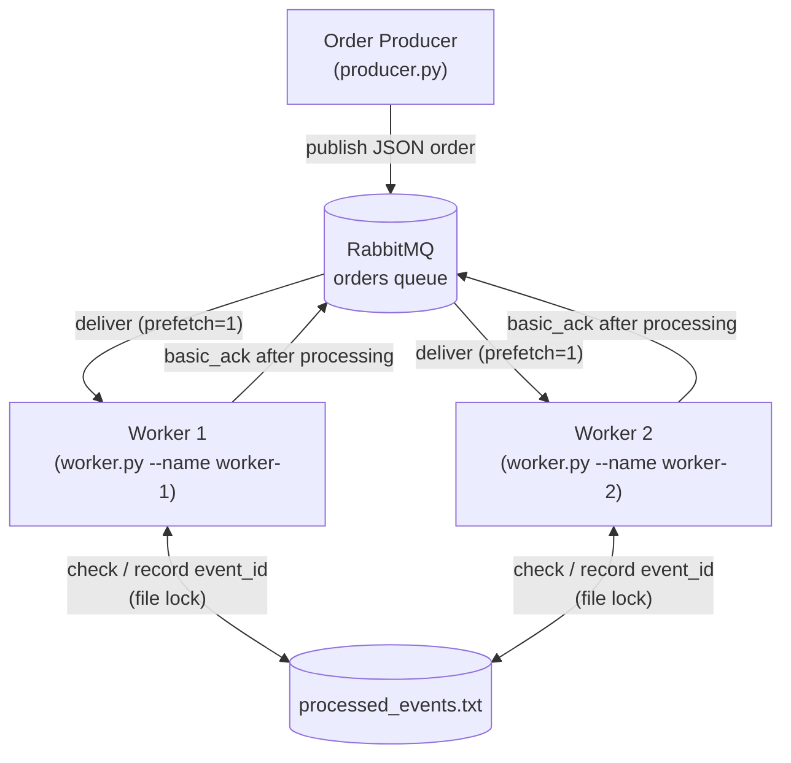
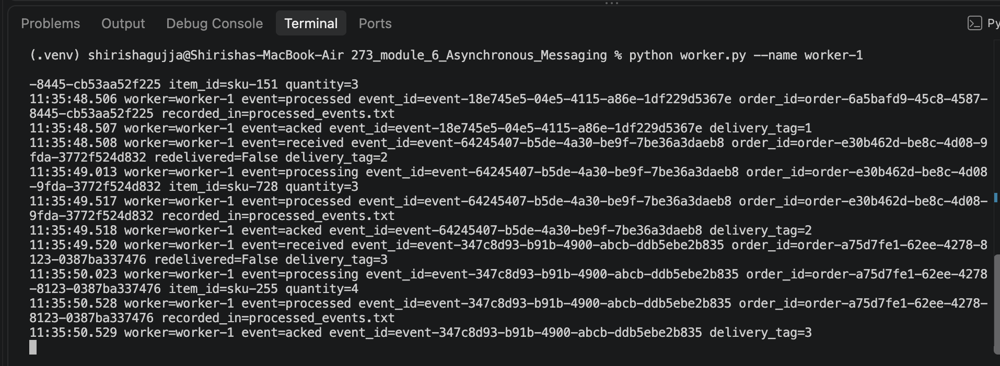
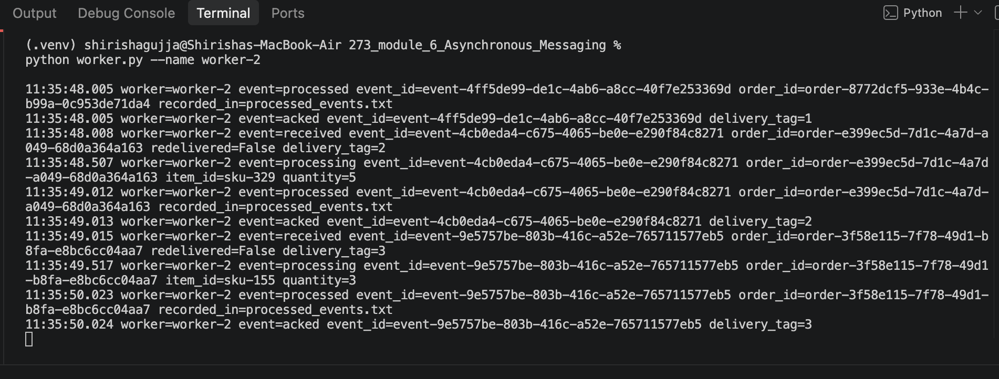
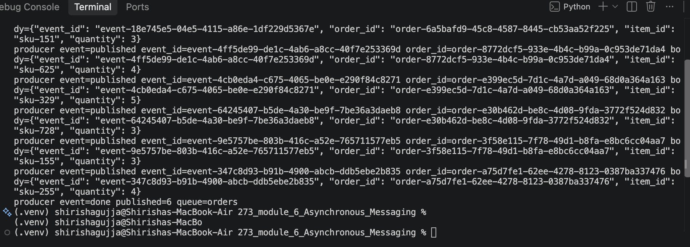
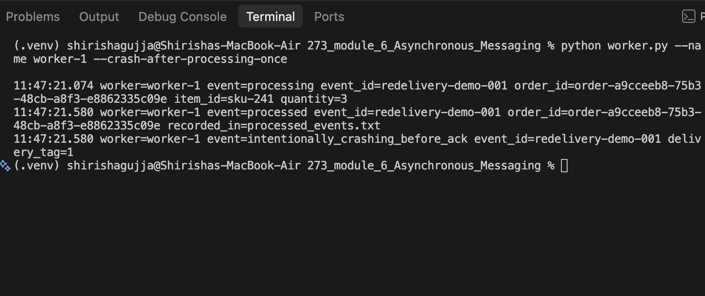
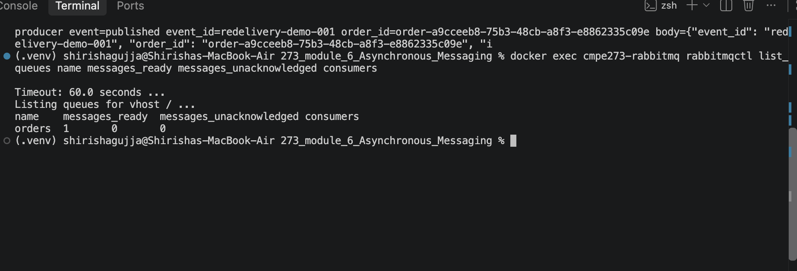
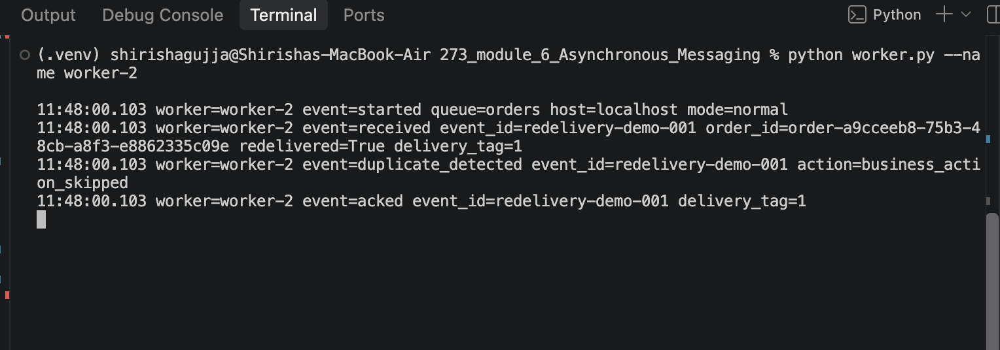
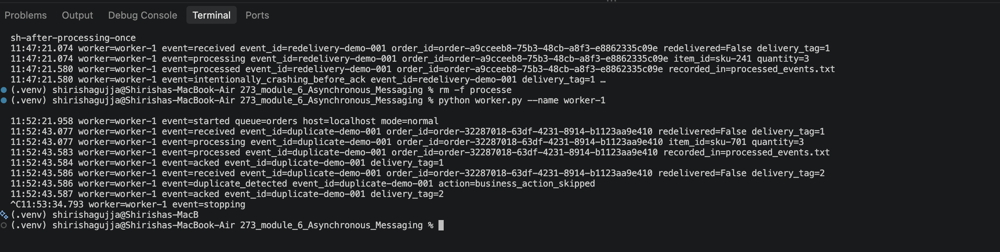
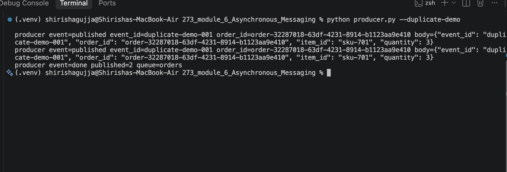

# CMPE 273 – Asynchronous Messaging with RabbitMQ

## 1. Overview

This project has two independent Python processes that talk through RabbitMQ:

- **Order Producer** (`producer.py`) publishes order events as JSON to a queue named `orders`.
- **RabbitMQ** stores the messages in the durable `orders` queue and delivers them to consumers.
- **Order Worker** (`worker.py`) consumes orders **asynchronously**, so the producer doesn't wait for processing.
- **Two workers** (`worker-1`, `worker-2`) can run against the **same** queue at the same time. They are *competing consumers*: RabbitMQ gives each message to only one of them.

Each worker uses **manual acknowledgements** (`auto_ack=False`). It ACKs a message only after processing finishes. It also records every processed `event_id` in a shared file, so a redelivered or duplicate message never runs the business action twice.

## 2. Architecture Diagram



There is only one queue. Worker 1 and Worker 2 both consume from it.

## 3. Message Contract

Every message body is JSON with exactly these fields:

```json
{
  "event_id": "event-629ac54a-89a2-48ef-827e-21af8f4e22cc",
  "order_id": "order-8e6afa7d-f691-4505-9efe-8d9267838c93",
  "item_id": "sku-807",
  "quantity": 3
}
```

| Field      | Meaning                                                        |
|------------|----------------------------------------------------------------|
| `event_id` | Unique ID of this event (UUID by default). Used for duplicate detection. |
| `order_id` | The order being processed.                                     |
| `item_id`  | The SKU being ordered.                                         |
| `quantity` | How many units.                                                |

**Why `event_id`?** RabbitMQ can deliver the same message more than once, for example after a worker crashes before ACK. A redelivered message carries the same `event_id`, so a worker can check whether that event was already handled and skip the business action.

## 4. Install Dependencies

Requires Python 3 and Docker (for RabbitMQ).

```bash
python3 -m venv .venv
source .venv/bin/activate
python -m pip install -r requirements.txt
```

`requirements.txt` contains only `pika==1.4.4`.

## 5. Run RabbitMQ

First time (creates the container):

```bash
docker run -d \
  --name cmpe273-rabbitmq \
  -p 5672:5672 \
  -p 15672:15672 \
  rabbitmq:3-management
```

If the container already exists (e.g. after a reboot), restart it instead of recreating it:

```bash
docker start cmpe273-rabbitmq
```

RabbitMQ takes a few seconds to start. Check that it is ready:

```bash
docker logs cmpe273-rabbitmq 2>&1 | grep "Server startup complete"
```

Optional: you can inspect the queue at the management UI, http://localhost:15672 (default guest login, local only), or from the CLI:

```bash
docker exec cmpe273-rabbitmq rabbitmqctl list_queues name messages_ready messages_unacknowledged consumers
```

Both scripts connect to `localhost:5672` by default. Set `RABBITMQ_HOST` to use another host, e.g. `RABBITMQ_HOST=myhost python worker.py --name worker-1`.

## 6. Run Producer

```bash
# Publish 6 unique orders (random UUID event_ids)
python producer.py --count 6

# Publish one order with a specific event_id (used for the redelivery demo)
python producer.py --count 1 --event-id redelivery-demo-001

# Duplicate demo: publish the SAME order (same event_id) twice
python producer.py --duplicate-demo
# optionally choose the duplicated event_id
python producer.py --duplicate-demo --event-id my-dup-001
```

## 7. Run Workers

Open two terminals (with the venv activated in each):

```bash
# Terminal 1
python worker.py --name worker-1
```

```bash
# Terminal 2
python worker.py --name worker-2
```

These are two **independent OS processes**. Each opens its own connection to RabbitMQ and consumes from the **same** `orders` queue. Each worker sets `basic_qos(prefetch_count=1)`, so it holds at most one unacknowledged message at a time and work is shared fairly.

Failure test mode (used in section 10):

```bash
python worker.py --name worker-1 --crash-after-processing-once
```

Stop a worker with **Ctrl+C**.

### Worker processing flow

```text
receive message
   ↓
lock processed_events.txt, check event_id
   ├── already recorded → log duplicate_detected, skip business action ──┐
   └── new → process order (sleep 0.5s) → record event_id               │
                                                                         ↓
                                              basic_ack (after processing)
```

In `--crash-after-processing-once` mode, the worker calls `os._exit(1)` right after recording the `event_id` and **before** `basic_ack`. This exit kills the process immediately: no `finally`/`except` block runs, so the code cannot ACK by accident. The OS then closes the TCP connection, and RabbitMQ requeues the unacknowledged message.

## 8. Successful Message Processing Evidence

This is real output from a test run. One message goes from `published` → `received` → `processing` → `processed` → `acked`:

```text
producer event=published event_id=event-629ac54a-89a2-48ef-827e-21af8f4e22cc order_id=order-8e6afa7d-f691-4505-9efe-8d9267838c93 body={"event_id": "event-629ac54a-89a2-48ef-827e-21af8f4e22cc", "order_id": "order-8e6afa7d-f691-4505-9efe-8d9267838c93", "item_id": "sku-807", "quantity": 3}
```

```text
21:41:24.135 worker=worker-2 event=received event_id=event-629ac54a-89a2-48ef-827e-21af8f4e22cc order_id=order-8e6afa7d-f691-4505-9efe-8d9267838c93 redelivered=False delivery_tag=1
21:41:24.641 worker=worker-2 event=processing event_id=event-629ac54a-89a2-48ef-827e-21af8f4e22cc order_id=order-8e6afa7d-f691-4505-9efe-8d9267838c93 item_id=sku-807 quantity=3
21:41:25.142 worker=worker-2 event=processed event_id=event-629ac54a-89a2-48ef-827e-21af8f4e22cc order_id=order-8e6afa7d-f691-4505-9efe-8d9267838c93 recorded_in=processed_events.txt
21:41:25.143 worker=worker-2 event=acked event_id=event-629ac54a-89a2-48ef-827e-21af8f4e22cc delivery_tag=1
```

The `acked` line always comes after `processed`. The ACK is sent only once processing has finished.

## 9. Competing Consumers Evidence

**Steps:**

```bash
rm -f processed_events.txt                 # test reset only
python worker.py --name worker-1           # Terminal 1
python worker.py --name worker-2           # Terminal 2
python producer.py --count 6               # Terminal 3
```

### Screenshots

**Terminal 1: worker-1**



**Terminal 2: worker-2**



**Terminal 3: producer**



**Who handled which event (from the screenshots above):**

| Published event_id (prefix) | Handled by |
|---|---|
| `event-18e745e5…` | worker-1 (Terminal 1) |
| `event-4ff5de99…` | worker-2 (Terminal 2) |
| `event-4cb0eda4…` | worker-2 (Terminal 2) |
| `event-64245407…` | worker-1 (Terminal 1) |
| `event-9e5757be…` | worker-2 (Terminal 2) |
| `event-347c8d93…` | worker-1 (Terminal 1) |

All 6 published events were handled, 3 by each worker. No event appears in both workers' output.

### Text log output

The text logs below come from a separate verification run, so their UUIDs differ from the screenshots.

**Producer (Terminal 3)**, real output:

```text
producer event=published event_id=event-629ac54a-89a2-48ef-827e-21af8f4e22cc order_id=order-8e6afa7d-f691-4505-9efe-8d9267838c93 body={"event_id": "event-629ac54a-89a2-48ef-827e-21af8f4e22cc", "order_id": "order-8e6afa7d-f691-4505-9efe-8d9267838c93", "item_id": "sku-807", "quantity": 3}
producer event=published event_id=event-b199d2af-41be-4929-b98f-7aa3b56e952e order_id=order-529bfa99-9080-443e-9039-9204ae5f4283 body={"event_id": "event-b199d2af-41be-4929-b98f-7aa3b56e952e", "order_id": "order-529bfa99-9080-443e-9039-9204ae5f4283", "item_id": "sku-935", "quantity": 4}
producer event=published event_id=event-e6e7d1d3-62ee-4740-9beb-515034b7b7bf order_id=order-5a35959d-1ab4-442b-a4bf-e6ed087ab6fd body={"event_id": "event-e6e7d1d3-62ee-4740-9beb-515034b7b7bf", "order_id": "order-5a35959d-1ab4-442b-a4bf-e6ed087ab6fd", "item_id": "sku-863", "quantity": 2}
producer event=published event_id=event-971df420-e56f-48ea-9108-4b6ec49c8bca order_id=order-b9e007df-bbb2-478c-8882-5a470c8cdd37 body={"event_id": "event-971df420-e56f-48ea-9108-4b6ec49c8bca", "order_id": "order-b9e007df-bbb2-478c-8882-5a470c8cdd37", "item_id": "sku-880", "quantity": 4}
producer event=published event_id=event-430ccf36-1d44-4acf-a049-ac1471a40241 order_id=order-473c7881-a50f-4213-8c93-75d76525cd6c body={"event_id": "event-430ccf36-1d44-4acf-a049-ac1471a40241", "order_id": "order-473c7881-a50f-4213-8c93-75d76525cd6c", "item_id": "sku-944", "quantity": 2}
producer event=published event_id=event-8daf9514-9701-4a74-8315-51d6dd936f68 order_id=order-f7bcf50a-746d-4b03-b82a-9ead3e9ca64b body={"event_id": "event-8daf9514-9701-4a74-8315-51d6dd936f68", "order_id": "order-f7bcf50a-746d-4b03-b82a-9ead3e9ca64b", "item_id": "sku-943", "quantity": 3}
producer event=done published=6 queue=orders
```

**worker-1 (Terminal 1)**, real output:

```text
21:41:22.124 worker=worker-1 event=started queue=orders host=localhost mode=normal
21:41:24.135 worker=worker-1 event=received event_id=event-b199d2af-41be-4929-b98f-7aa3b56e952e order_id=order-529bfa99-9080-443e-9039-9204ae5f4283 redelivered=False delivery_tag=1
21:41:24.135 worker=worker-1 event=processing event_id=event-b199d2af-41be-4929-b98f-7aa3b56e952e order_id=order-529bfa99-9080-443e-9039-9204ae5f4283 item_id=sku-935 quantity=4
21:41:24.641 worker=worker-1 event=processed event_id=event-b199d2af-41be-4929-b98f-7aa3b56e952e order_id=order-529bfa99-9080-443e-9039-9204ae5f4283 recorded_in=processed_events.txt
21:41:24.641 worker=worker-1 event=acked event_id=event-b199d2af-41be-4929-b98f-7aa3b56e952e delivery_tag=1
21:41:24.644 worker=worker-1 event=received event_id=event-e6e7d1d3-62ee-4740-9beb-515034b7b7bf order_id=order-5a35959d-1ab4-442b-a4bf-e6ed087ab6fd redelivered=False delivery_tag=2
21:41:25.143 worker=worker-1 event=processing event_id=event-e6e7d1d3-62ee-4740-9beb-515034b7b7bf order_id=order-5a35959d-1ab4-442b-a4bf-e6ed087ab6fd item_id=sku-863 quantity=2
21:41:25.648 worker=worker-1 event=processed event_id=event-e6e7d1d3-62ee-4740-9beb-515034b7b7bf order_id=order-5a35959d-1ab4-442b-a4bf-e6ed087ab6fd recorded_in=processed_events.txt
21:41:25.649 worker=worker-1 event=acked event_id=event-e6e7d1d3-62ee-4740-9beb-515034b7b7bf delivery_tag=2
21:41:25.650 worker=worker-1 event=received event_id=event-430ccf36-1d44-4acf-a049-ac1471a40241 order_id=order-473c7881-a50f-4213-8c93-75d76525cd6c redelivered=False delivery_tag=3
21:41:26.154 worker=worker-1 event=processing event_id=event-430ccf36-1d44-4acf-a049-ac1471a40241 order_id=order-473c7881-a50f-4213-8c93-75d76525cd6c item_id=sku-944 quantity=2
21:41:26.657 worker=worker-1 event=processed event_id=event-430ccf36-1d44-4acf-a049-ac1471a40241 order_id=order-473c7881-a50f-4213-8c93-75d76525cd6c recorded_in=processed_events.txt
21:41:26.657 worker=worker-1 event=acked event_id=event-430ccf36-1d44-4acf-a049-ac1471a40241 delivery_tag=3
```

**worker-2 (Terminal 2)**, real output:

```text
21:41:22.124 worker=worker-2 event=started queue=orders host=localhost mode=normal
21:41:24.135 worker=worker-2 event=received event_id=event-629ac54a-89a2-48ef-827e-21af8f4e22cc order_id=order-8e6afa7d-f691-4505-9efe-8d9267838c93 redelivered=False delivery_tag=1
21:41:24.641 worker=worker-2 event=processing event_id=event-629ac54a-89a2-48ef-827e-21af8f4e22cc order_id=order-8e6afa7d-f691-4505-9efe-8d9267838c93 item_id=sku-807 quantity=3
21:41:25.142 worker=worker-2 event=processed event_id=event-629ac54a-89a2-48ef-827e-21af8f4e22cc order_id=order-8e6afa7d-f691-4505-9efe-8d9267838c93 recorded_in=processed_events.txt
21:41:25.143 worker=worker-2 event=acked event_id=event-629ac54a-89a2-48ef-827e-21af8f4e22cc delivery_tag=1
21:41:25.145 worker=worker-2 event=received event_id=event-971df420-e56f-48ea-9108-4b6ec49c8bca order_id=order-b9e007df-bbb2-478c-8882-5a470c8cdd37 redelivered=False delivery_tag=2
21:41:25.648 worker=worker-2 event=processing event_id=event-971df420-e56f-48ea-9108-4b6ec49c8bca order_id=order-b9e007df-bbb2-478c-8882-5a470c8cdd37 item_id=sku-880 quantity=4
21:41:26.154 worker=worker-2 event=processed event_id=event-971df420-e56f-48ea-9108-4b6ec49c8bca order_id=order-b9e007df-bbb2-478c-8882-5a470c8cdd37 recorded_in=processed_events.txt
21:41:26.154 worker=worker-2 event=acked event_id=event-971df420-e56f-48ea-9108-4b6ec49c8bca delivery_tag=2
21:41:26.156 worker=worker-2 event=received event_id=event-8daf9514-9701-4a74-8315-51d6dd936f68 order_id=order-f7bcf50a-746d-4b03-b82a-9ead3e9ca64b redelivered=False delivery_tag=3
21:41:26.657 worker=worker-2 event=processing event_id=event-8daf9514-9701-4a74-8315-51d6dd936f68 order_id=order-f7bcf50a-746d-4b03-b82a-9ead3e9ca64b item_id=sku-943 quantity=3
21:41:27.158 worker=worker-2 event=processed event_id=event-8daf9514-9701-4a74-8315-51d6dd936f68 order_id=order-f7bcf50a-746d-4b03-b82a-9ead3e9ca64b recorded_in=processed_events.txt
21:41:27.159 worker=worker-2 event=acked event_id=event-8daf9514-9701-4a74-8315-51d6dd936f68 delivery_tag=3
```

**Summary of who handled which event:**

| # | event_id (prefix) | Handled by |
|---|-------------------|------------|
| 1 | `event-629ac54a…` | worker-2 |
| 2 | `event-b199d2af…` | worker-1 |
| 3 | `event-e6e7d1d3…` | worker-1 |
| 4 | `event-971df420…` | worker-2 |
| 5 | `event-430ccf36…` | worker-1 |
| 6 | `event-8daf9514…` | worker-2 |

- One queue (`orders`) with two separate worker processes consuming from it.
- Both workers received work: 3 messages each.
- No `event_id` appears in both workers' logs, so each message went to exactly one consumer.
- The queue was empty afterwards: `orders  messages_ready=0  messages_unacknowledged=0  consumers=2`.
- RabbitMQ does not promise strict alternation. The split was even here, but the exact assignment can differ between runs.

> Note: the two workers share one file lock around "check → process → record". This prevents a race on the same `event_id`, but it also means business actions don't overlap in time (visible in the timestamps above). That is an acceptable simplification for this lab. A production system would use a database with a unique constraint or per-key locking instead.

## 10. Failure and Redelivery Evidence

This demo is deterministic: only the crash-mode worker is running when the message is published.

**Steps:**

```bash
# Step 1 – test reset only
rm -f processed_events.txt

# Step 2 – Terminal 1: start worker-1 in crash mode
python worker.py --name worker-1 --crash-after-processing-once

# Step 3 – Terminal 3: publish exactly one known message
python producer.py --count 1 --event-id redelivery-demo-001

# (optional) inspect the queue: the message is back in "ready", not lost
docker exec cmpe273-rabbitmq rabbitmqctl list_queues name messages_ready messages_unacknowledged consumers

# Step 4 – Terminal 2: start worker-2 normally
python worker.py --name worker-2
```

### Screenshots

**Terminal 1: worker-1 (crash mode, stops before ACK)**



**Terminal 3: producer + queue check**



**Terminal 2: worker-2 (receives the redelivered message)**



**What the screenshots show:**

1. **Terminal 1:** worker-1 processed `redelivery-demo-001` (`order-a9cceeb8…`), recorded it, then logged `intentionally_crashing_before_ack` and exited. There is no `acked` line.
2. **Terminal 3:** after worker-1 died, the queue shows `orders 1 0 0`. The unacknowledged message went back to *ready* and was not lost, and no consumers were connected.
3. **Terminal 2:** worker-2 received the **same** `event_id` and `order_id` with `redelivered=True`. It logged `duplicate_detected action=business_action_skipped`, so the business action was not repeated, and then `acked` the message.

### Text log output

The text logs below come from a separate verification run, so their timestamps and UUIDs differ from the screenshots.

**Producer**, real output:

```text
producer event=published event_id=redelivery-demo-001 order_id=order-7b871363-0eab-4d0c-8831-3e5295be466c body={"event_id": "redelivery-demo-001", "order_id": "order-7b871363-0eab-4d0c-8831-3e5295be466c", "item_id": "sku-657", "quantity": 1}
producer event=done published=1 queue=orders
```

**Queue while worker-1 holds the message.** It has been delivered but not ACKed:

```text
name	messages_ready	messages_unacknowledged	consumers
orders	0	1	1
```

**worker-1 (crash mode)**, real output. It receives, processes, and records the event, then dies **before ACK** (process exit code 1). There is no `acked` line:

```text
21:41:56.974 worker=worker-1 event=started queue=orders host=localhost mode=crash-after-processing-once
21:41:58.999 worker=worker-1 event=received event_id=redelivery-demo-001 order_id=order-7b871363-0eab-4d0c-8831-3e5295be466c redelivered=False delivery_tag=1
21:41:58.999 worker=worker-1 event=processing event_id=redelivery-demo-001 order_id=order-7b871363-0eab-4d0c-8831-3e5295be466c item_id=sku-657 quantity=1
21:41:59.505 worker=worker-1 event=processed event_id=redelivery-demo-001 order_id=order-7b871363-0eab-4d0c-8831-3e5295be466c recorded_in=processed_events.txt
21:41:59.505 worker=worker-1 event=intentionally_crashing_before_ack event_id=redelivery-demo-001 delivery_tag=1
```

**Queue after worker-1 died.** The connection closed without an ACK, so RabbitMQ moved the message back to *ready*:

```text
name	messages_ready	messages_unacknowledged	consumers
orders	1	0	0
```

`processed_events.txt` at this point:

```text
redelivery-demo-001
```

**worker-2 (normal)**, real output. It gets the **same `event_id`**, RabbitMQ marks it `redelivered=True`, and worker-2 skips the business action and ACKs:

```text
21:41:59.810 worker=worker-2 event=started queue=orders host=localhost mode=normal
21:41:59.812 worker=worker-2 event=received event_id=redelivery-demo-001 order_id=order-7b871363-0eab-4d0c-8831-3e5295be466c redelivered=True delivery_tag=1
21:41:59.812 worker=worker-2 event=duplicate_detected event_id=redelivery-demo-001 action=business_action_skipped
21:41:59.812 worker=worker-2 event=acked event_id=redelivery-demo-001 delivery_tag=1
```

**Queue afterwards.** The message was ACKed and removed:

```text
name	messages_ready	messages_unacknowledged	consumers
orders	0	0	1
```

**The system keeps running.** A new order published afterwards was processed normally by worker-2:

```text
21:42:03.093 worker=worker-2 event=received event_id=event-c86ebbf6-4925-4daa-b4e9-43b46e42e14b order_id=order-e4fe15ed-4bd1-407a-8cc6-585006770d9c redelivered=False delivery_tag=2
21:42:03.093 worker=worker-2 event=processing event_id=event-c86ebbf6-4925-4daa-b4e9-43b46e42e14b order_id=order-e4fe15ed-4bd1-407a-8cc6-585006770d9c item_id=sku-893 quantity=3
21:42:03.599 worker=worker-2 event=processed event_id=event-c86ebbf6-4925-4daa-b4e9-43b46e42e14b order_id=order-e4fe15ed-4bd1-407a-8cc6-585006770d9c recorded_in=processed_events.txt
21:42:03.600 worker=worker-2 event=acked event_id=event-c86ebbf6-4925-4daa-b4e9-43b46e42e14b delivery_tag=2
```

What this shows:

1. worker-1 received `redelivery-demo-001`.
2. worker-1 processed it and recorded the `event_id`.
3. worker-1 stopped before sending the ACK.
4. The message stayed unacknowledged (`messages_unacknowledged=1`), then went back to ready (`messages_ready=1`) when the connection dropped.
5. RabbitMQ redelivered it (`redelivered=True`).
6. worker-2 received the **same** `event_id` (and the same `order_id`).
7. worker-2 did **not** repeat the business action, ACKed the message, and kept processing new orders.

## 11. Duplicate Handling Evidence

**Steps:**

```bash
rm -f processed_events.txt                 # test reset only
python worker.py --name worker-1           # Terminal 1
python producer.py --duplicate-demo        # Terminal 3
```

### Screenshots

**Terminal 1: worker-1**



**Terminal 3: producer**



**What the screenshots show:**

1. **Terminal 3:** the producer published the identical message twice (`event_id=duplicate-demo-001`, same `order_id=order-32287018…`), ending with `published=2`.
2. **Terminal 1, first copy (`delivery_tag=1`):** `received` → `processing` → `processed` → `acked`. The business action ran.
3. **Terminal 1, second copy (`delivery_tag=2`):** `received` → `duplicate_detected action=business_action_skipped` → `acked`. There is **no `processing` line**, so the business action was not performed twice. The duplicate was still ACKed, so it does not stay in the queue.

### Text log output

The text logs below come from a separate verification run, so their timestamps and UUIDs differ from the screenshots.

**Producer**, real output. The identical message is published twice:

```text
producer event=published event_id=duplicate-demo-001 order_id=order-722319e2-b2ba-44df-85db-3f1627717efb body={"event_id": "duplicate-demo-001", "order_id": "order-722319e2-b2ba-44df-85db-3f1627717efb", "item_id": "sku-224", "quantity": 2}
producer event=published event_id=duplicate-demo-001 order_id=order-722319e2-b2ba-44df-85db-3f1627717efb body={"event_id": "duplicate-demo-001", "order_id": "order-722319e2-b2ba-44df-85db-3f1627717efb", "item_id": "sku-224", "quantity": 2}
producer event=done published=2 queue=orders
```

**worker-1**, real output:

```text
21:42:14.550 worker=worker-1 event=started queue=orders host=localhost mode=normal
21:42:16.565 worker=worker-1 event=received event_id=duplicate-demo-001 order_id=order-722319e2-b2ba-44df-85db-3f1627717efb redelivered=False delivery_tag=1
21:42:16.566 worker=worker-1 event=processing event_id=duplicate-demo-001 order_id=order-722319e2-b2ba-44df-85db-3f1627717efb item_id=sku-224 quantity=2
21:42:17.071 worker=worker-1 event=processed event_id=duplicate-demo-001 order_id=order-722319e2-b2ba-44df-85db-3f1627717efb recorded_in=processed_events.txt
21:42:17.072 worker=worker-1 event=acked event_id=duplicate-demo-001 delivery_tag=1
21:42:17.075 worker=worker-1 event=received event_id=duplicate-demo-001 order_id=order-722319e2-b2ba-44df-85db-3f1627717efb redelivered=False delivery_tag=2
21:42:17.075 worker=worker-1 event=duplicate_detected event_id=duplicate-demo-001 action=business_action_skipped
21:42:17.076 worker=worker-1 event=acked event_id=duplicate-demo-001 delivery_tag=2
21:42:18.869 worker=worker-1 event=stopping
```

- First delivery (`delivery_tag=1`): `processing` → `processed` → `acked`.
- Second delivery of the same `event_id` (`delivery_tag=2`): `duplicate_detected action=business_action_skipped` → `acked`. There is **no `processing` line**, so the business action ran only once.
- The duplicate was ACKed after it was identified, and the queue ended empty (`messages_ready=0 messages_unacknowledged=0`).
- `processed_events.txt` contains `duplicate-demo-001` exactly once.
- The last line (`event=stopping`) shows a clean shutdown with Ctrl+C.

## 12. Reflection

**Why can a message be delivered more than once, and how does idempotent handling help?**

With manual acknowledgements, RabbitMQ keeps a message until the consumer sends an ACK. If a worker receives a message but crashes or disconnects before ACKing, RabbitMQ requeues it and delivers it again, possibly to a different worker. The broker cannot tell whether the work finished before the crash, so redelivering is the only way to make sure no message is lost, and the same event may therefore arrive twice. By recording each `event_id` once it is processed, a worker can recognize a repeat delivery, skip the business action, and simply ACK it. This idempotent handling means "at-least-once delivery" still has the effect of each order being processed only once.

## Cleanup

- Stop each worker with **Ctrl+C** in its terminal.
- Stop RabbitMQ (the container and its data are kept; restart later with `docker start cmpe273-rabbitmq`):

  ```bash
  docker stop cmpe273-rabbitmq
  ```

- Reset the processed-event state between demos (test reset only):

  ```bash
  rm -f processed_events.txt
  ```

## Project Files

| File | Purpose |
|------|---------|
| `producer.py` | Publishes JSON order messages to the `orders` queue (`--count`, `--event-id`, `--duplicate-demo`). |
| `worker.py` | Consumes from `orders` with manual ACK and prefetch=1, does duplicate detection through `processed_events.txt`, and has an optional crash-before-ACK test mode. |
| `requirements.txt` | Python dependency (`pika`). |
| `.gitignore` | Ignores the venv, caches, and the runtime file `processed_events.txt`. |
| `screenshots/` | Terminal screenshots used as evidence in sections 9–11. |
| `processed_events.txt` | *Runtime only*, created by workers, one processed `event_id` per line. Not committed. |
